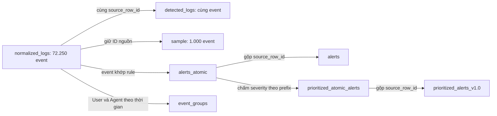

# Bộ dữ liệu chuẩn hóa và kết quả rule-based

`data/processed/` chứa log đã chuẩn hóa, kết quả rule, nhóm sự kiện và metadata. Tài liệu này mô tả nội dung, schema, quan hệ giữa các bảng và quy tắc tạo dữ liệu.

## 1. Danh sách file

| File CSV | Số bản ghi | Số cột | Nội dung |
|---|---:|---:|---|
| normalized_logs.csv | 72.250 | 43 | Toàn bộ log sau chuẩn hóa |
| detected_logs.csv | 72.250 | 47 | Cùng bộ log, thêm bốn cột kết quả phát hiện |
| normalized_logs_sample.csv | 1.000 | 43 | Tập con giữ nguyên ID nguồn để xem thử dữ liệu |
| alerts_atomic.csv | 1.301 | 11 | Alert theo từng cặp source_row_id/rule_id |
| alerts.csv | 1.301 | 12 | Alert đã gộp theo source_row_id |
| prioritized_atomic_alerts.csv | 1.301 | 11 | Alert từng rule sau chấm severity, có severity_reason giải thích trực tiếp mức cuối |
| prioritized_alerts_v1.0.csv | 1.301 | 12 | Alert sau chấm severity đã gộp theo source_row_id; giữ lý do chi tiết của từng rule trong rule_matches |
| event_groups.csv | 7.501 | 12 | Snapshot nhóm sự kiện User/Agent theo thời gian |

normalized_logs và detected_logs là hai biểu diễn của **cùng 72.250 event**, không phải hai tập độc lập để cộng số lượng. Sample nằm trong bộ đầy đủ. Raw log có thể chứa xuống dòng, nên số dòng văn bản của file không bằng số bản ghi CSV.

Các file kèm theo:

- Mỗi CSV có `.schema.json` cùng tên: dtype, null marker, checksum, phiên bản và provenance.
- `../../preprocessing/data_bundle.py`: reader độc lập, chỉ cần Python/pandas; không import code từ project gốc.
- `requirements.txt`: pandas 2.3.3; reader đã kiểm chứng trên Python 3.12.14.
- `MANIFEST.json`: danh sách, dung lượng và SHA-256 của mọi file bàn giao trừ chính manifest.
- `VALIDATION.json`: kết quả kiểm tra gói, số lượng và các invariant đã đối chiếu.
- `analysis_outputs.manifest.json`: provenance lịch sử của bộ alert/group; không phải manifest cho toàn bộ gói hiện tại.
- `.gitattributes`: tắt chuyển đổi line ending để Git giữ nguyên byte/checksum và raw log nhiều dòng.
- `.gitignore`: bỏ qua cache Python và môi trường cục bộ khi đưa thư mục lên Git.

Đường dẫn `data/...` hoặc `reports/task7/...` trong provenance là vị trí xuất tại project gốc, không cần tồn tại ở máy người nhận. Mọi dữ liệu và metadata cần đọc đều nằm ngay trong thư mục này.

## 2. Schema log chuẩn hóa

43 cột gồm 24 cột nguồn và 19 cột quản lý/chuẩn hóa. Dtype từng cột được ghi đầy đủ trong normalized_logs.schema.json.

| Nhóm | Các cột | Ý nghĩa |
|---|---|---|
| Khóa và thứ tự | source_row_id, record_index, id | Khóa bàn giao, vị trí bản ghi nguồn và id nguồn |
| Thời gian | Timestamp, hour, day_of_week, date | Datetime không timezone; hour 0–23; day_of_week 0=Monday đến 6=Sunday |
| Ngữ cảnh | Activity, Action, Decoder_name, User, Agent_name | Chuỗi đã strip/casefold |
| Nội dung nghiệp vụ | Url, Command, Path, Filename, To, Cc, Bcc, From | Text theo loại event; trường rỗng/thiếu tùy loại log |
| Số liệu | Attachments, Size, Size_before, Size_after, Level | Float64 nullable, giữ số âm để kiểm tra; Level là mức nguồn |
| Raw điều tra | Full_log, Description, Content | Giữ nguyên nội dung, quote, khoảng trắng, hoa/thường và xuống dòng |
| Cờ chất lượng | invalid_timestamp, timestamp_error, has_numeric_issue | Lỗi parse thời gian hoặc vấn đề số liệu được ghi nhận |
| Bản trước xử lý số | Attachments_raw, Size_raw, Size_before_raw, Size_after_raw, Level_raw | Chuỗi nguồn trước ép kiểu |
| Bản trước chuẩn hóa | Timestamp_raw, Activity_raw, Action_raw, Decoder_name_raw, User_raw, Agent_name_raw | Giá trị trước parse/strip/casefold |
| Nhãn tham chiếu | Anomaly | String nguồn: 41.541 giá trị 1 và 30.709 giá trị 0 |

Snapshot giữ đủ 72.250 event nguồn. Hiện có 0 timestamp lỗi, 1.372 event thiếu User; không tự điền unknown để ghép các user thiếu. Giá trị thiếu được giữ theo kiểu nullable, không tự thay bằng trung bình hoặc 0. Các bước encoding/scaling/feature selection không nằm trong gói đã chuẩn hóa này.

## 3. Bốn cột thêm trong detected_logs

| Cột | Kiểu sau đọc | Ý nghĩa |
|---|---|---|
| rule_ids | list[str] | Rule khớp chính event hiện tại; [] nếu không có alert |
| alert_count | Int64 | Số rule khớp event hiện tại, bằng len(rule_ids) |
| group_id | nullable string | Nhóm của event; null nếu thiếu dữ liệu để nhóm |
| severity | nullable string | LOW/MEDIUM/HIGH/CRITICAL; null khi không có alert |

Có 1.301 event có alert và 70.949 event không có alert. Phân phối severity sau điều chỉnh: LOW 48, MEDIUM 635, HIGH 446, CRITICAL 172. Null severity không đồng nghĩa LOW.

Severity ở alerts.csv/alerts_atomic.csv là **mức gốc của rule**. Severity ở detected_logs.csv và hai bảng prioritized đã được **điều chỉnh theo prefix ngữ cảnh**. Có **675 event tăng mức** và 626 event có alert giữ mức gốc; không có event giảm mức. Các bảng này là những cách biểu diễn của cùng tập alert, không phải alert mới để cộng số lượng.

### Lý do cho severity cuối

- `prioritized_atomic_alerts.csv`: cột `severity` là mức cuối của từng rule match; `severity_reason` giải thích trực tiếp mức gốc, số event alert đã thấy, số loại hoạt động đã thấy, giờ nguồn, bước tăng và trần. Đây là bảng xem lý do điều chỉnh chi tiết.
- `prioritized_alerts_v1.0.csv`: một dòng/source_row_id; `severity` là mức cuối cao nhất trong các rule match. `severity_reason` ở mức gộp giải thích việc lấy mức cao nhất; lý do điều chỉnh cụ thể của từng rule nằm ở `rule_matches[].severity_reason`.
- `reason` và `evidence` giữ nguyên ý nghĩa detector: điều kiện khớp và raw nguồn. Không ghi đè chúng bằng lý do severity.
- Khóa nối với detected_logs là `source_row_id`; mức cuối của bảng prioritized đã được đối chiếu khớp hoàn toàn với `detected_logs.severity` trên 1.301 event có alert. Các event không có alert vẫn có severity=null và không có dòng trong bảng prioritized.

## 4. Khóa nối và quan hệ giữa các bảng

Khóa chung là **source_row_id** theo định dạng `<SHA256 file nguồn>:<record_index đệm ít nhất 8 số>`. record_index là vị trí bản ghi CSV nguồn, không phải dòng vật lý khi raw chứa newline. Giữ nguyên ID khi copy/đọc/nối bảng; không hash lại CSV đã xuất để tạo khóa mới. Index pandas, thứ tự dòng hiện tại và id nguồn không thay thế khóa này.



- normalized_logs ↔ detected_logs: **1:1**, 43 cột ban đầu giống chính xác.
- normalized_logs_sample là tập con của normalized_logs, giữ nguyên mọi giá trị và ID gốc.
- alerts_atomic → event: **nhiều:1** theo thiết kế; cặp source_row_id/rule_id duy nhất. alerts → event: tối đa **1:1** sau gộp. Hai bảng hiện cùng 1.301 dòng vì không có event khớp nhiều rule đang bật trong snapshot này.
- prioritized_atomic_alerts có cùng các cặp source_row_id/rule_id với alerts_atomic; prioritized_alerts_v1.0 có cùng tập event và rule_ids với alerts. Chỉ mức ưu tiên/lý do ưu tiên được cập nhật; context, detector reason và evidence giữ nguyên. Atomic vẫn có thể nhiều dòng/event trong dữ liệu khác; dùng bảng prioritized gộp khi cần quan hệ một dòng/event.
- event_groups.source_row_ids là danh sách ID theo Timestamp/record_index; mỗi event thuộc tối đa một nhóm. key chứa User/Agent. start_time/end_time là thời gian đầu/cuối nhóm; activities và rule_ids là danh sách của snapshot nhóm.
- 7.501 nhóm bao phủ 70.878 event; 1.372 event thiếu User không có nhóm. Trong 1.301 event có alert, 1.131 có nhóm và 170 không có nhóm. Không loại 170 alert này khi đối chiếu nhóm.
- alert_count ở detected_logs đếm rule của **event hiện tại**; alert_count ở event_groups đếm **event có alert trong cả snapshot nhóm**. rule_match_count của nhóm đếm cặp event/rule, có thể lớn hơn số event alert.

## 5. Reader và tính toàn vẹn

`preprocessing/data_bundle.py` cung cấp hai hàm:

| Hàm | Kết quả |
|---|---|
| verify_bundle(base_dir=None) | Kiểm tra SHA-256 tất cả file trong MANIFEST.json, trả danh sách tên file hợp lệ; sai checksum/thiếu file thì báo lỗi |
| load_table(filename="normalized_logs.csv", base_dir=None) | Đọc một trong tám CSV bằng sidecar, trả pandas DataFrame |

Mặc định reader tìm bundle trong `data/processed/`, không phụ thuộc working directory. Nó chỉ đọc dữ liệu, không sửa file; khôi phục JSON list/dict, datetime/date, numeric/boolean nullable và phân biệt null với chuỗi rỗng hoặc chuỗi raw như NA. pd.read_csv mặc định không bảo đảm các quy ước này.

Giữ CSV và sidecar cùng nhau, không chỉnh tay CSV rồi tiếp tục dùng checksum/schema cũ. Manifest không tự hash chính nó để tránh vòng tham chiếu. Mỗi lần cập nhật gói cần đồng bộ schema, dung lượng, số lượng và checksum của các file liên quan.

## 6. Rule và quy ước tạo dữ liệu

### Quy ước chuẩn hóa và bảo toàn

- Giữ đủ 72.250 event nguồn; không loại dòng chỉ vì thiếu User hoặc lỗi thời gian. Timestamp lỗi được gắn invalid_timestamp/timestamp_error; các bước cần thời gian hợp lệ sẽ bỏ qua có thống kê.
- Parse Timestamp theo định dạng nguồn millisecond, giữ datetime không timezone; sort theo Timestamp/record_index. Thêm hour, day_of_week, date.
- Strip/casefold Activity, Action, Decoder_name, User, Agent_name; giữ bản trước chuẩn hóa ở các cột *_raw. User trống là missing, không tự điền unknown hoặc đoán người dùng.
- Attachments, Size, Size_before, Size_after, Level dùng kiểu số nullable; giữ chuỗi gốc ở *_raw và gắn has_numeric_issue. Giá trị âm được giữ để kiểm tra, không tự thay 0/trung bình.
- source_row_id duy nhất được tạo từ SHA-256 file nguồn và record_index trước sort. Giữ nguyên khóa khi xuất/đọc và nối bảng; không tạo lại từ CSV đã chuẩn hóa.
- Full_log, Description, Content giữ nguyên, kể cả hoa/thường, khoảng trắng, dấu quote và xuống dòng. Không dùng làm sạch chuỗi cho ba cột raw này.
- Anomaly không được tham gia rule/correlation/severity; Level không được coi là severity. Tên Activity không tự chứng minh tấn công.

### Rule phát hiện đang bật và tắt

Rule tạo gói này có phiên bản spedia.rules.v1; toàn bộ điều kiện cần đọc được mô tả ngay bên dưới, không cần file cấu hình của repo gốc. Bảng dưới mô tả đúng cấu hình tạo ra gói dữ liệu hiện tại; số khớp là số alert, không phải số tấn công được xác nhận.

| rule_id | Trạng thái | Điều kiện khớp chính | Severity gốc | Số alert |
|---|---|---|---|---:|
| CMD_NMAP | Bật | Action=command executed và basename của Command đúng nmap | MEDIUM | 47 |
| CMD_JOHN | Bật | Action=command executed và basename của Command đúng john | MEDIUM | 185 |
| CMD_MSFCONSOLE | Bật | Action=command executed và basename của Command đúng msfconsole | MEDIUM | 105 |
| FILE_CONFIG_CHANGE | Bật | Action là file modified/added/deleted và Path khớp nhóm cấu hình bên dưới; loại modified chỉ đổi mtime/ctime nếu raw xác nhận | MEDIUM | 851 |
| HTTP_IP_HOST | Bật | Action=url accedida hoặc url accessed; Url HTTP(S) có hostname là IPv4/IPv6 literal hợp lệ | LOW | 105 |
| AUTH_FAILURE_WINDOW | Bật | Failure rõ; ít nhất 3 dòng failure cùng User/Agent trong 300 giây tính đến dòng hiện tại | MEDIUM | 8 |
| CMD_NETCAT | **Tắt mặc định** | Nếu chủ động bật: Action=command executed và Command có basename nc/netcat/socat | LOW | Không tính vào 1.301 alert hiện hành |

**Command:** so tên executable có phân biệt hoa/thường theo cấu hình Linux hiện tại; Action so sau strip/casefold. Ví dụ /usr/bin/nmap được lấy basename nmap; nmap-helper không khớp chỉ vì chứa chữ nmap. Engine không phân tích toàn bộ command line/shell để trích executable hoặc tham số. Log có tên tool vẫn cần đối chiếu raw và ủy quyền; CMD_NMAP có thể dựa vào log kết thúc tiến trình, chưa xác minh một lần quét mạng. Netcat tắt do công cụ đa mục đích, tín hiệu thiếu tham số dễ gây nhiễu; việc triển khai condition không đồng nghĩa rule được bật.

**File cấu hình:** các Path được theo dõi là /etc/apache2/, /etc/ssh/, /etc/vsftpd.conf, /etc/passwd, /etc/shadow, /etc/sudoers và /etc/sudoers.d/. Regex cấu hình chính xác:

```text
^/etc/(?:apache2/|ssh/|vsftpd\.conf$|passwd$|shadow$|sudoers(?:$|\.d/))
```

Chỉ xét Action thay đổi tương ứng. Với file modified, loại trường hợp Full_log khớp mẫu Changed attributes chỉ gồm mtime/ctime rồi tới Old; không tự loại khi raw thiếu hoặc khi thay đổi nội dung/quyền/inode. Added/deleted không áp dụng bộ lọc metadata-only này. Đây là điều chỉnh kỹ thuật khi đối chiếu raw log, giảm 1.211 ứng viên xuống 851 alert, không dựa vào Anomaly. Rule hiện dùng Path; không có rule chỉ dựa vào đuôi Filename hoặc tên Activity. HTTP cũng không cảnh báo chỉ vì đuôi .php/.jsp hoặc suy diễn traversal khi chưa có mẫu được xác nhận.

**Failure xác thực:** bật vì khảo sát nguồn đã xác nhận 330 dòng failure rõ. Signal là Action chính xác login failed/multiple failed logins hoặc regex ngữ cảnh authentication failure, user login failed, failed password/publickey, login failed/failure, multiple failed logins trong Action/Description/Full_log. Không dùng Content cho rule auth hiện tại và không coi từ fail/denied/invalid bất kỳ ở mọi ngữ cảnh là login failure.

Đếm theo cặp (User, Agent_name) trong cửa sổ đóng `[t − 300 giây, t]`; bao gồm dòng hiện tại, thứ tự Timestamp/record_index quyết định prefix khi trùng timestamp. Dòng failure thứ ba trở đi đạt ngưỡng sẽ tạo alert tại chính dòng đó. Mỗi dòng multiple failed logins chỉ tính một lần; thành công không reset cửa sổ và failure không cần liên tiếp. Thiếu User thì không đếm, không suy từ raw sang một danh tính mới; 216/330 failure nguồn thiếu User là giới hạn đã ghi nhận. Chưa kết luận brute force hoặc gom mọi failure thành SSH failure.

**Điều kiện dữ liệu chung:** event cần Timestamp hợp lệ, Agent_name/Activity không rỗng để tạo alert theo hợp đồng. Command/Path/Url phải có giá trị phù hợp với rule đang xét. Thiếu hẳn cột bắt buộc theo rule bật thì báo lỗi, không âm thầm tắt rule; thiếu giá trị ở từng dòng thì không khớp và được thống kê. Missing User chỉ bắt buộc loại khỏi auth/correlation, không loại khỏi mọi command/file/HTTP rule. Activity là ngữ cảnh alert, không được dùng riêng để kết luận tấn công.

### Rule gộp alert và correlation

- Gộp alert theo source_row_id; rule_ids sort/duy nhất, rule_matches giữ mọi reason/evidence. Bản gửi lặp chính xác cùng source/rule được bỏ; nội dung hoặc context mâu thuẫn báo lỗi. Không gộp hai source ID khác nhau chỉ vì raw giống nhau.
- Nhóm theo User chính và Agent_name phụ, không gộp các agent khác nhau hoặc mọi user thiếu thành một người.
- Cửa sổ nhóm là **fixed window 900 giây** căn theo epoch đồng hồ nguồn, biên `[bucket_start,bucket_end)`. Trong cùng User/Agent/bucket, tách khi gap giữa hai event **lớn hơn 300 giây**; bằng 300 giây chưa tách.
- Pipeline dùng min_events=1 để group_id của event cũ không chờ một event tương lai mới xuất hiện. Hai event rất gần nhau nhưng ở hai phía biên bucket vẫn có thể thuộc hai nhóm khác nhau.
- Correlation 900s/fixed-gap khác cửa sổ rolling 300s của auth. Nhóm chỉ cung cấp ngữ cảnh, không xác nhận chuỗi tấn công. Không lấy summary cuối nhóm làm feature cho event trước đó.

### Rule điều chỉnh severity

Policy tạo gói này có phiên bản spedia.severity.v1. Mức gốc lấy từ bảng rule trên, không cộng dồn dựa trên severity của lần chạy trước. Các yếu tố được tính chỉ đến anchor hiện tại:

| Yếu tố | Điều chỉnh |
|---|---|
| Prefix nhóm có dưới 3 event được cảnh báo | +0 bậc |
| Có 3–9 event được cảnh báo | +1 bậc |
| Có từ 10 event được cảnh báo | +2 bậc, thay cho mức +1 |
| Có ít nhất 3 loại hoạt động khác nhau trong prefix nhóm | +1 bậc |
| Giờ nguồn ngoài `[08:00,18:00)` | +1 bậc |
| Thiếu nhóm hoặc yếu tố không đạt điều kiện | Yếu tố đó +0, không tự giảm mức |

Thứ tự LOW=0, MEDIUM=1, HIGH=2, CRITICAL=3. Công thức là `final = min(3, base + min(count_steps + activity_steps + hour_steps, 2))`: tổng tăng ngữ cảnh tối đa 2 bậc, kết quả không vượt CRITICAL. Số event alert là số source_row_id duy nhất, không phải số rule match; tính cả event hiện tại. Loại hoạt động đếm cả event không có alert đã xuất hiện, không phân loại tên Activity nào là tấn công. Không có cơ chế tự giảm vì trong giờ làm việc hoặc thiếu dữ liệu.

Giờ 08:00–18:00 chỉ là giả định prototype trên đồng hồ nguồn naive, chưa xác minh timezone/lịch trực/cuối tuần; có thể đổi/tắt yếu tố giờ khi nhóm xác minh. Không dùng Anomaly/Level hoặc ML để tăng/giảm severity. Dòng không có alert có severity=null trong detected_logs, không được đồng nhất với LOW. Severity vẫn chỉ là ưu tiên xử lý, không phải mức tác động đã xác minh.


## 7. Giới hạn và ý nghĩa kết quả

- Anomaly là nhãn tham chiếu, không được dùng làm đầu vào rule/severity hoặc suy ra từ kết quả detector. Level nguồn không phải severity prototype.
- Có alert không đồng nghĩa Anomaly=1; zero alert không đồng nghĩa bình thường. Theo đánh giá tham chiếu của snapshot, FILE_CONFIG_CHANGE có 851 alert mang nhãn 0; tổng rule có precision khoảng 34,59% và recall khoảng 1,08%. Đây là mô tả trên toàn dataset, không phải đánh giá holdout hay xác minh tấn công.
- **Severity chỉ là mức ưu tiên xử lý prototype, không phải mức tác động đã xác minh.** Tên Activity, tool hoặc URL không tự chứng minh tấn công.
- rule_ids/alert_count/group_id/severity của từng event chỉ dựa trên hiện tại/quá khứ với cùng source IDs và policy. Snapshot cuối của event_groups có thể gồm sự kiện đến sau so với một event cũ; end_time/count/activities/rule_ids cuối nhóm không phải thông tin đã biết ở mọi thời điểm trước đó.
- Group ID ổn định khi chỉ nối thêm event tương lai với cùng khóa/policy. Late arrival, đổi byte file nguồn hoặc đổi policy có thể cần tạo snapshot/namespace mới.
- Giờ nguồn không có timezone đã xác minh; lịch vận hành và quyền thực thi tool chưa được xác nhận. Không thay nhãn hoặc raw để làm kết quả rule phù hợp kỳ vọng.

## 8. Kết quả kiểm tra gói bàn giao

VALIDATION.json ghi số lượng, schema, khóa nối, raw/nhãn, count/severity và các phép đối chiếu thực tế. Sáu CSV ban đầu và sidecar giữ nguyên byte; hai bảng prioritized và sidecar là bản sao đã xác minh từ snapshot Task 7. Reader đã đọc được cả tám bảng độc lập với code project gốc. Lý do ưu tiên cuối đầy đủ trên 1.301 alert, bao gồm 675 event tăng mức; MANIFEST.json được đồng bộ với toàn bộ tài liệu/dữ liệu hiện tại.

