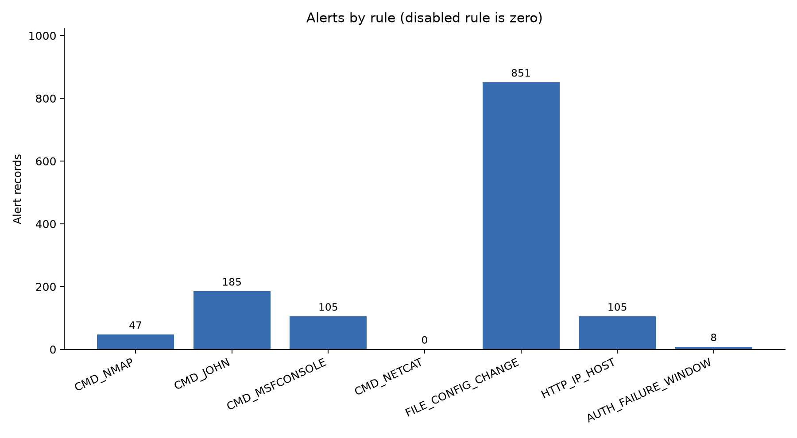
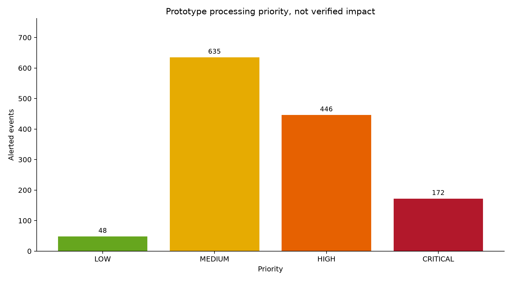
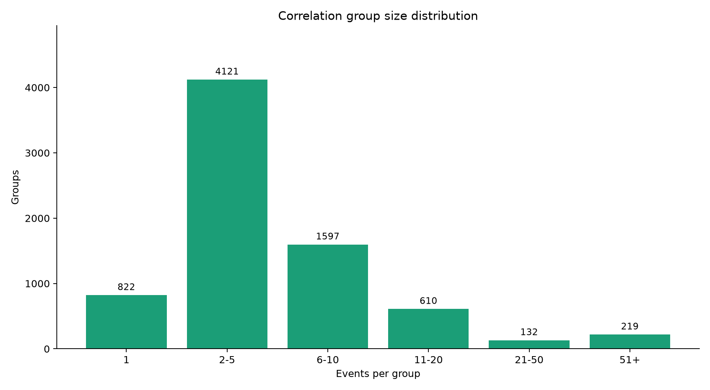

# Biên bản Task 9 — Kiểm thử và tối ưu

Ngày chốt: **24/11/2026**, múi giờ Asia/Saigon.

## 1. Kết quả kiểm thử cuối

Toàn bộ suite chạy qua pytest: **198 test pass, 90 subtest pass, 0 failed, 0 error, 0 skipped**. Lần cuối sau tối ưu và bổ sung regression Correlation hoàn tất khoảng **67,05 giây**. Không bỏ qua test ML đang có trong repo, test Streamlit hoặc hai test full dataset.

- [pytest_final.log](pytest_final.log): log đầy đủ lần cuối.
- [pytest_final.xml](pytest_final.xml): JUnit dùng cho đối chiếu tự động.
- [test_summary.json](test_summary.json): số ca, thời gian và hash JUnit.
- [test_cases.csv](test_cases.csv): từng test cấp cao, module, kết quả, thời gian và lỗi nếu có. 90 subtest là các ca con trong unittest; không ghi nhầm chúng thành 90 test cấp cao bổ sung.

Môi trường: Python 3.12.14; pandas 3.0.5, NumPy 2.5.2, Streamlit 1.61.1, scikit-learn 1.9.1, joblib 1.6.0 theo requirements.txt; pytest 9.2.0 và matplotlib 3.11.2 từ requirements-dev.txt. Phiên bản đầy đủ ở [environment.txt](environment.txt).

## 2. Ma trận ca kiểm thử

Task 9 thêm **35 ca cấp cao** trong [test_task9_boundaries.py](../../tests/test_task9_boundaries.py), đồng thời chạy toàn bộ các test đã có. Danh sách từng ca cụ thể và trạng thái nằm trong test_cases.csv.

| Nhóm ca | Kịch bản | Kết quả mong đợi đã xác nhận |
|---|---|---|
| File rỗng | 0 byte, chỉ BOM, chỉ whitespace, chỉ header | LogLoadError có status=error, rows_loaded=0; không báo zero alert thành công giả |
| Thiếu schema | Thiếu lần lượt id/Timestamp/Activity/Action/User/Agent_name | Exception và load_report nêu đúng cột thiếu |
| Timestamp lỗi | Sai format, ngày không tồn tại, timezone ngoài hợp đồng; test cũ còn có None/chuỗi rỗng/out-of-range | Giữ event, gắn invalid_timestamp/timestamp_error, không tạo alert/group trên thời gian lỗi |
| Cột tùy ngữ cảnh toàn rỗng | User, Command, Path, Url, Decoder_name, Full_log, Description, Content | Giữ đủ event; User thiếu không bị gộp unknown, Command trống không khớp command rule, raw rỗng giữ nguyên |
| Cột giá trị bắt buộc toàn rỗng | Timestamp, Agent_name, Activity, Action, id | Loader từ chối rõ thay vì xóa event âm thầm |
| Một dòng / user một event | Một CSV nmap hợp lệ | Một event, một alert, một nhóm, timeline có raw và has_alert=True |
| Trùng timestamp / chưa sort | Bốn event cùng timestamp, đảo dòng và index trùng | Thứ tự được xác định bởi record_index; alert/group không đổi; mức tăng chỉ từ prefix |
| Nullable string backend | string[python] và string[pyarrow] | activities/rule_ids/source_row_ids giữ đúng list; không mất metadata do scalar representation |
| User/Agent/bucket/gap | Tách identity, biên 900s và gap bằng/vượt 300s | Không ghép khác key; đúng biên cửa sổ và inactivity gap; không renumber nhóm cũ khi xuất hiện user mới |
| Tái lập file nhỏ | Cùng byte upload chạy hai lần | Atomic/merged alerts, nhóm, bảng event và feature giống chính xác; timing được loại khỏi tiêu chí bằng nhau |
| File lớn thật | CSV 45.703.322 byte / 72.250 event | Không bỏ dòng; 1.301 alert, 7.501 nhóm; raw và feature khớp snapshot bàn giao |
| Tái lập full dataset | Hai lần chạy độc lập trên toàn CSV | Nội dung semantic bằng nhau, kể cả ID, rule_ids, group_id, severity và raw |
| Độc lập nhãn/ML | Không có/đổi Anomaly, Level, truyền ML placeholder | Rule/correlation/severity không lấy nhãn hoặc score ML làm đầu vào |
| Round-trip và dữ liệu cũ | CSV/schema đúng, sai checksum, empty typed table, null/empty, legacy alert | Reader/writer đúng kiểu; lỗi rõ; bảng cũ vẫn đọc được |
| Dashboard | Chưa upload, upload có alert, zero alert, lỗi schema, lọc rerun | Trạng thái phân biệt rõ; alert/evidence/timeline hiển thị; không tính detection chỉ trên view đã lọc |
| ML backend hiện có | Inference contract, không cần Anomaly, cửa sổ chỉ nhìn quá khứ | Khôi phục chức năng đã merge; không huấn luyện lại model, không ghép score ML vào severity |
| Cache model | Cùng version file gọi hai lần, sau đó thay file | Load một lần khi file không đổi; thay mtime/size tạo lần load mới |

## 3. Lỗi phát hiện và cách sửa

| Mã | Mức | Hiện tượng | Sửa / bằng chứng |
|---|---|---|---|
| T9-01 | P0 | ml_engine.py bị trả về khung, thiếu predict/prepare_ml_input; test ML không import được | Khôi phục implementation đã có trong HEAD; cả ba test ML chạy thật với artifact sẵn có và pass |
| T9-02 | P0 | Dashboard dùng entrypoint cũ, không gọi pipeline; lần đầu còn có native access violation tại đường pd.read_csv cũ trong AppTest | Khôi phục entrypoint gọi views/service rule-based, loader kiểm tra schema. Bốn test dashboard và AppTest toàn 72.250 event pass. Không kết luận đã sửa một lỗi upstream của pandas; đường lỗi trong ứng dụng cũ đã được thay |
| T9-03 | P0 | pandas 3.0.5: boolean value of NA is ambiguous khi mask format/range của Timestamp kết hợp backend Arrow và nullable | Ép các mask nonempty/format/range thành bool không-null trước khi kết hợp; giữ nguyên cờ missing/invalid và không mất dòng |
| T9-04 | P1 | DATA.md đã được chỉnh sau manifest nên verify_bundle báo checksum mismatch | Giữ nguyên nội dung tài liệu hiện có, chỉ đồng bộ bytes/SHA entry của DATA.md. Chi tiết [manifest_repair.json](manifest_repair.json); CSV/schema không đổi |
| T9-05 | P1 | Correlation tốn khoảng 7,580s trên pandas 3 và đường agg(list) cũ làm activities của 7.501 nhóm thành [] | Temporary object arrays tối ưu membership/list aggregation, đồng thời khôi phục activities và dtype list theo snapshot. Group ID/membership/count/time và alert/features không đổi; có regression Python/Arrow và so toàn bộ group table |
| T9-06 | P2 | Inference nạp lại joblib khi file model không đổi | Cache tối đa 3 pipeline theo resolved path/mtime_ns/size; test kiểm tra reuse và invalidation. Không fit hoặc sửa artifact model |
| T9-07 | P2 | Chưa có pytest/dev dependency và cấu hình runner thống nhất | Thêm requirements-dev.txt, pytest.ini, runner ghi log/JUnit có timeout; toàn bộ suite được chạy, không lọc bỏ ca lỗi |

Native Windows error dialog được tắt **chỉ trong process chạy test và con của nó** để crash trả exit code/log thay vì treo hộp thoại không người xử lý. Runner không biến crash thành pass. Log baseline giữ nguyên tại [pytest_baseline.log](pytest_baseline.log), có exit native access violation; lần baseline không hoàn tất nên không có kết quả pass/JUnit hợp lệ để tuyên bố.

Sau khôi phục app/ML, [pytest_diagnostic.xml](pytest_diagnostic.xml) ghi **194 pass, 1 fail**, lỗi còn lại là mask Timestamp. Sau sửa mask/cache, [pytest_pre_optimization.xml](pytest_pre_optimization.xml) ghi 196 pass + 90 subtest. Sau tối ưu Correlation, suite cuối cũng pass toàn bộ như mục 1.

Đối chiếu thêm bằng đường agg(list) cũ được dựng lại trong bộ nhớ cho thấy metadata activities sai ở 7.501 nhóm trên backend nullable Arrow; rule_ids ở snapshot này không đổi. source_row_ids đổi từ dtype list[pyarrow] về object chứa Python list theo hợp đồng bàn giao. Bằng chứng [group_metadata_regression.json](group_metadata_regression.json). Vì có sửa metadata thật, không dùng sự bằng nhau của SHA semantic trước/sau như tiêu chí tối ưu; tiêu chí đúng là nhóm sau sửa khớp toàn bộ bảng frozen, còn mỗi lần chạy của phiên bản cuối phải tái lập chính xác.

## 4. Số liệu chốt toàn dataset

### Theo rule

| Rule | Trạng thái | Alert |
|---|---|---:|
| CMD_NMAP | Bật | 47 |
| CMD_JOHN | Bật | 185 |
| CMD_MSFCONSOLE | Bật | 105 |
| FILE_CONFIG_CHANGE | Bật | 851 |
| HTTP_IP_HOST | Bật | 105 |
| AUTH_FAILURE_WINDOW | Bật | 8 |
| CMD_NETCAT | Tắt | 0 trong luồng hiện hành |
| **Tổng** | | **1.301** |

### Theo severity cuối

| Mức ưu tiên | Event có alert |
|---|---:|
| LOW | 48 |
| MEDIUM | 635 |
| HIGH | 446 |
| CRITICAL | 172 |
| **Tổng** | **1.301** |

70.949 event không có alert, severity=null; không gộp chúng vào LOW. Severity là ưu tiên xử lý prototype, không phải mức tác động đã xác minh.

### Correlation

| Chỉ tiêu | Số lượng |
|---|---:|
| Tổng nhóm | 7.501 |
| Event trong nhóm | 70.878 |
| Event không có nhóm | 1.372 |
| Event có alert trong nhóm | 1.131 |
| Event có alert không có nhóm | 170 |
| Nhóm một event | 822 |
| Số event lớn nhất một nhóm | 2.482 |

Phân phối số event/nhóm: 1 event = 822 nhóm; 2–5 = 4.121; 6–10 = 1.597; 11–20 = 610; 21–50 = 132; trên 50 = 219. Các summary là snapshot cuối nhóm, không phải feature đã biết cho mọi event quá khứ.

## 5. Bằng chứng tái lập, hiệu năng và biểu đồ

Lần chốt sau cùng chạy pipeline độc lập hai lần, so sánh exact atomic/merged, toàn bộ group table và detected logs. SHA semantic bỏ qua timing được ghi tại [final_summary.json](final_summary.json); dữ liệu đã chốt khớp bản detected_logs trong gói bàn giao. Không dùng số liệu từ model ML để tính các bảng thống kê này.

Đối chiếu raw từng Full_log/Description/Content với CSV nguồn bằng reader độc lập. Hash nguồn, rules, severity policy, schema/freeze, dữ liệu data/, toàn bộ gói data_for_ml và các model đã có giữ nguyên trong lần chốt. Việc đồng bộ checksum tài liệu diễn ra trước lần chốt, được ghi riêng tại manifest_repair.json.

| File | Tác dụng |
|---|---|
| [alerts_by_rule.csv](alerts_by_rule.csv) | Count mỗi rule, trạng thái enabled và base severity |
| [alerts_by_severity.csv](alerts_by_severity.csv) | Count event theo mức cuối |
| [correlation_summary.csv](correlation_summary.csv) | Các count tổng hợp nhóm/event/alert |
| [correlation_group_sizes.csv](correlation_group_sizes.csv) | Phân phối số event trong nhóm |
| [timings.csv](timings.csv) | Thời gian từng bước của hai lần chạy chốt |
| [before_correlation_optimization.json](before_correlation_optimization.json) | Số liệu/timing trước tối ưu Correlation trên cùng môi trường |
| [correlation_profile_before.txt](correlation_profile_before.txt), [correlation_profile_after.txt](correlation_profile_after.txt) | cProfile chỉ rõ hotspot và kết quả tối ưu |
| [final_summary.json](final_summary.json) | Count, pytest, signature tái lập, UI full và hash file được bảo vệ |
| [finalization.log](finalization.log) | Log chạy chốt/biểu đồ/AppTest |

Hai lần profiling cùng dataset đo 7,580s → 0,995s, khoảng 7,6 lần trong probe này. Không coi đó là cam kết tốc độ mọi máy; thời gian end-to-end mới nhất ở timings.csv bao gồm chi phí thực từng bước. Thời gian test/model cold load còn chịu cache hệ điều hành và môi trường; cache model được xác minh bằng số lần load/invalidation, không quy mọi chênh lệch wall time cho một thay đổi code.

Biểu đồ có PNG và SVG, đã xem kiểm tra nhãn/số liệu:







SVG dùng để đưa vào báo cáo/slide ở độ phân giải tùy ý: [rule](alerts_by_rule.svg), [severity](alerts_by_severity.svg), [nhóm](correlation_group_sizes.svg).

## 6. Cách chạy lại

Chạy từ gốc repo với dataset/model cục bộ đầy đủ:

```powershell
.\.venv\Scripts\python.exe -m pip install -r requirements-dev.txt
.\.venv\Scripts\python.exe tests/run_task9_pytest.py --label final
.\.venv\Scripts\python.exe tests/validate_task9_dataset.py --check-dashboard
```

Runner gọi toàn bộ `python -m pytest`, không có bộ lọc bỏ test. Có thể gọi trực tiếp `python -m pytest -q --junitxml=reports/testing_optimization/pytest_final.xml`; runner thêm log bền vững, timeout và xử lý hộp thoại crash Windows. Nếu máy không có raw CSV thì hai test full_dataset sẽ skip rõ; điều đó **không được tính là lần chốt full thành công**, audit yêu cầu không có skip.

## 7. Giới hạn còn lại

Không có lỗi ưu tiên cao tái hiện trong suite cuối và lần chốt này. Phạm vi chưa bao gồm nghiệm thu trực tiếp của Tuấn, kiểm thử trình duyệt thủ công, streaming/late arrival, chính sách múi giờ/lịch trực đã xác minh hoặc ghép score ML vào rule/severity. ML backend được khôi phục cho các test/inference đang có, không thay cho Task 11 tích hợp ML với rule theo hợp đồng chung. Không thay rule/ngưỡng để tăng metric theo Anomaly, không sửa raw, không huấn luyện lại model trong Task 9.
